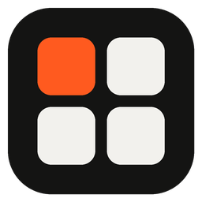
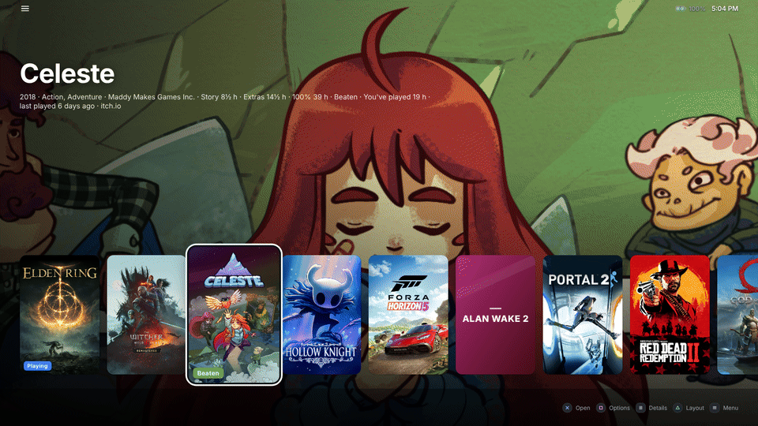
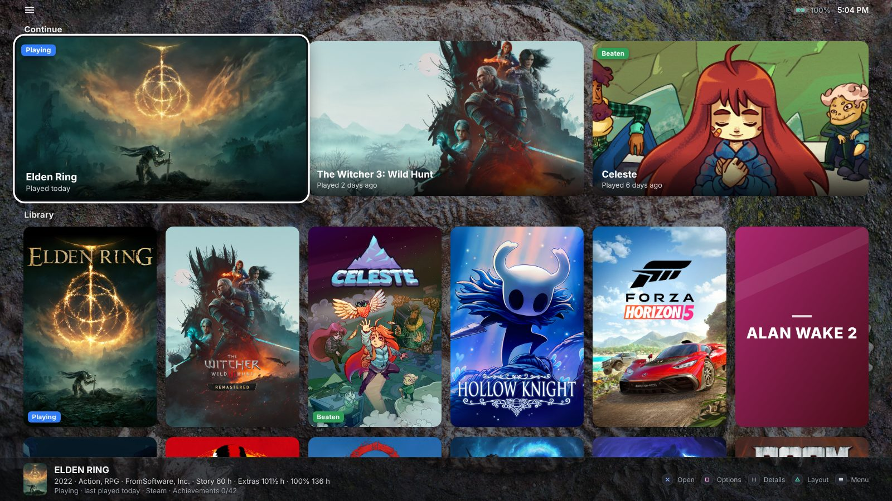
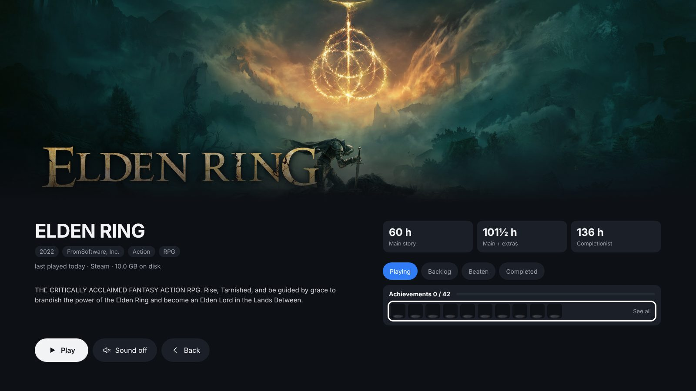
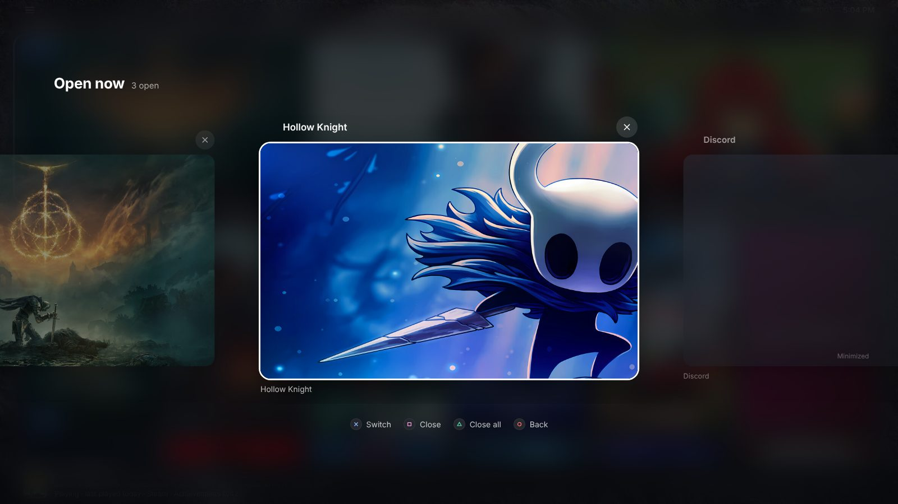
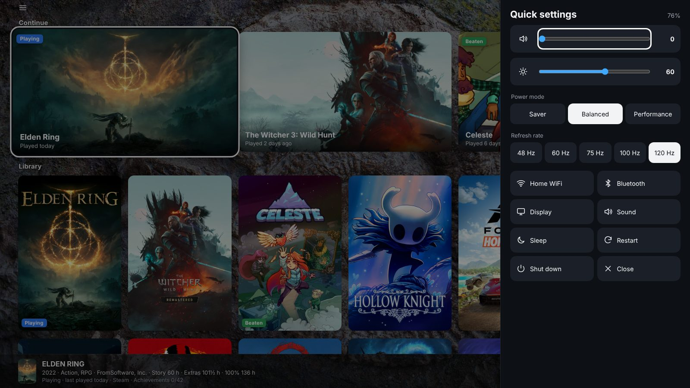
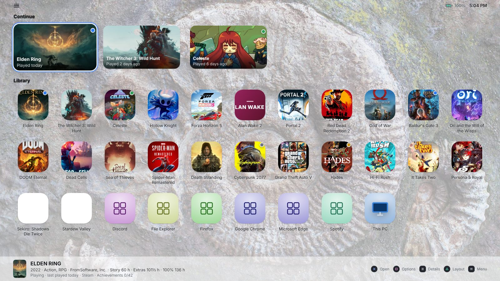
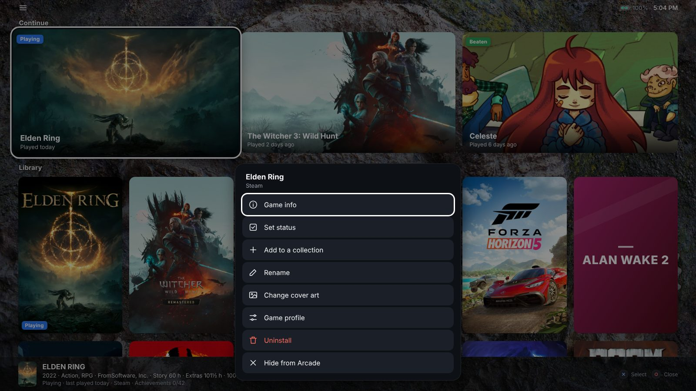

# Arcade Launcher

**Turn your Windows handheld into a console.** 
A free home screen and game launcher for ROG Ally, Legion Go, MSI Claw, Steam Deck (Windows) and every other Windows handheld.

**Steam** · **Xbox Game Pass** · **Epic** · **GOG** · **EA** · **Ubisoft** · **Battle.net** · **itch.io** · **RetroArch** 
All your games in one library. No logins, no ads, no account.

 

## Features

### Every store, one library

Your last games up top, everything else sorted the way you like. Steam, Game Pass, Epic, GOG, EA, Ubisoft and more, side by side.

### Know what to play

Trailers, How Long To Beat times, achievements, playtime and play status for every game.

### A Home button that goes home

Press Home once to come back to Arcade from any game. Press it twice to see everything that is running and switch, like on a phone.

### Quick settings, one press away

Volume, brightness, power mode, refresh rate, Wi-Fi and sleep without leaving the couch.

### Tiles, icons or console row

Pick the layout that suits your screen. Dark, light or OLED black, in English or Arabic.

### Edit anything with the controller

Rename, hide, change cover art, build collections, set per-game profiles or uninstall, all from one menu.

## Install

1. **[Download the latest version](https://github.com/AMSRS/Arcade-Launcher/releases/latest)**: `ArcadeLauncher-Setup` (installer) or `ArcadeLauncher-Portable` (zip).
2. Open it. A one-minute setup asks for your language, look, game folders and apps.
3. Turn on **Start with Windows** so your handheld boots straight into Arcade.

Windows 10 or 11, 64-bit. If Windows shows "Windows protected your PC", select **More info › Run anyway** (the app isn't code-signed yet).

## Why Arcade Launcher

| | |
|---|---|
| 🎮 **One library** | Steam (and non-Steam shortcuts), Xbox app / PC Game Pass, Epic, GOG, EA app, Ubisoft Connect, Battle.net, itch.io, RetroArch, your own emulators and game folders, plus your apps and folders |
| 🕹️ **Controller first** | PlayStation-style prompts, stick scrolling, a soft click and rumble on every move, on-screen keyboard, full touch support |
| 🏠 **Replaces the desktop** | Home button support, Open now app switcher, file manager, search, launch screen that hides the desktop while games start |
| ⏱️ **Game info** | How Long To Beat, trailers, achievements, playtime, install size, play status (Playing, Backlog, Beaten, Completed) |
| ⚡ **Handheld tools** | Quick settings, per-game refresh rate and power profiles, battery estimates, automatic save backups |
| 🎨 **Your look** | Big tiles, small icons or console row; dark, light, OLED black; accent colors; wallpapers; ambient or your own music |
| 🪶 **Light** | One small program that sits idle while you play. Free, no account, no ads, no telemetry. Auto-updates. |

## Controls

| ✕ | ○ | □ | △ | View | ☰ Menu | L3 | R3 | Home |
|---|---|---|---|---|---|---|---|---|
| Open | Back | Options | Layout | Game info | Menu | Quick settings | Search | Arcade · twice: Open now |

Touch and keyboard work too: arrows, Enter, Esc, or just start typing to search.

## Arcade Plus

Arcade Launcher is free. **Arcade Plus** is an optional one-time purchase that unlocks a few extras and keeps development going: the console row with moving backgrounds, accent colors and the OLED theme, your own wallpapers and music, per-game profiles, battery estimates, Steam friends and moving your setup to another PC. Get it in the app: **☰ › Get Arcade Plus**.

## Works on

**ASUS ROG Ally / Ally X / ROG Xbox Ally** · **Lenovo Legion Go / Go S** · **MSI Claw** · **AYANEO** · **ONEXPLAYER / OneXFly** · **AOKZOE** · **GPD Win** · **Steam Deck with Windows** · mini PCs and TV PCs with a controller

## FAQ

<b>Is it free?</b>
 Yes, on as many PCs as you like. Arcade Plus adds optional extras for a one-time price.

<b>Is it a Playnite or Steam Big Picture alternative?</b>
 Yes. It's a full-screen, controller-first library for all your games, and it's also made to replace the Windows desktop on a handheld: file manager, Home button app switcher, quick settings and per-game power profiles, set up in a minute with no plugins.

<b>Does it work with Xbox Game Pass, Epic and GOG?</b>
 Yes. Games from the Xbox app (PC Game Pass), Epic, GOG Galaxy, EA app, Ubisoft Connect, Battle.net, itch.io and RetroArch are found automatically, without logging in.

<b>Can my ROG Ally or Legion Go boot straight into it?</b>
 Yes. Turn on Start with Windows. With the Home button option on, Home takes you back to Arcade instead of the desktop.

<b>Will it slow down my games?</b>
 No. Arcade sits idle while a game runs. Moving backgrounds and Steam friends are off unless you turn them on.

<b>Can I add emulators?</b>
 Yes. RetroArch playlists are picked up automatically, and any emulator (PCSX2, Dolphin, DuckStation, PPSSPP…) can be added with its ROM folder.

<b>Where are my settings? Can I move them to another handheld?</b>
 In <code>%LOCALAPPDATA%\Arcade</code>. With Arcade Plus, Settings › Back up Arcade setup saves everything to a zip you can restore on another PC.

<b>Is it safe?</b>
 Arcade collects no data, shows no ads and needs no account. It goes online only for game art and info (Steam, HowLongToBeat, PCGamingWiki), wallpapers (Bing), update checks (GitHub) and Plus license checks.

## Support

⭐ **Star this repo** so other handheld owners find it · ☕ **[Ko-fi](https://ko-fi.com/amsrs)** · 💜 **[GitHub Sponsors](https://github.com/sponsors/AMSRS)** · 🐞 **[Report a bug or suggest an idea](https://github.com/AMSRS/Arcade-Launcher/issues/new/choose)**

Game data from HowLongToBeat, Steam and PCGamingWiki; wallpapers from Bing. Game names and artwork belong to their owners. Not affiliated with Valve, Microsoft, Epic Games, GOG, EA, Ubisoft, Blizzard, Sony or any handheld maker. Arcade Launcher is free to use but not open source; see [LICENSE](LICENSE).
