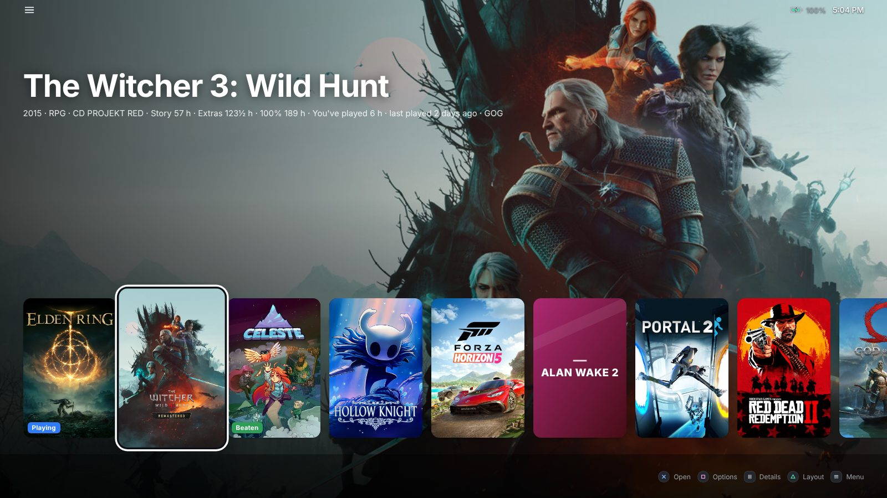
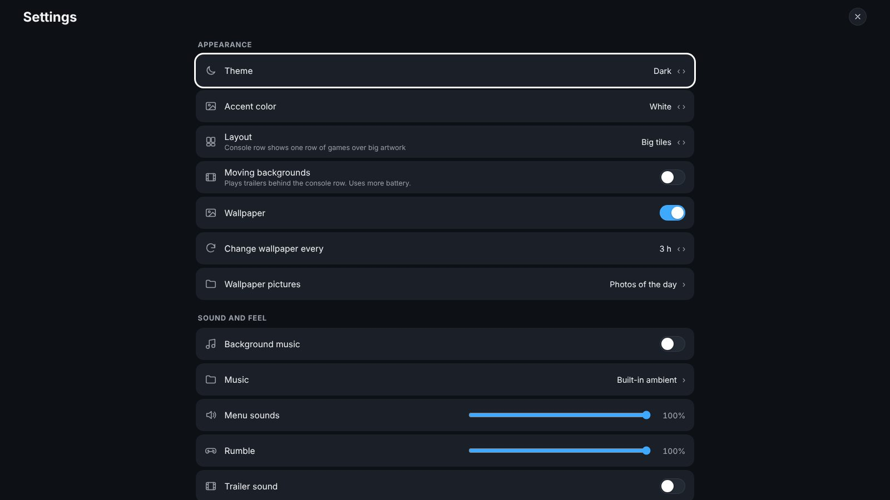
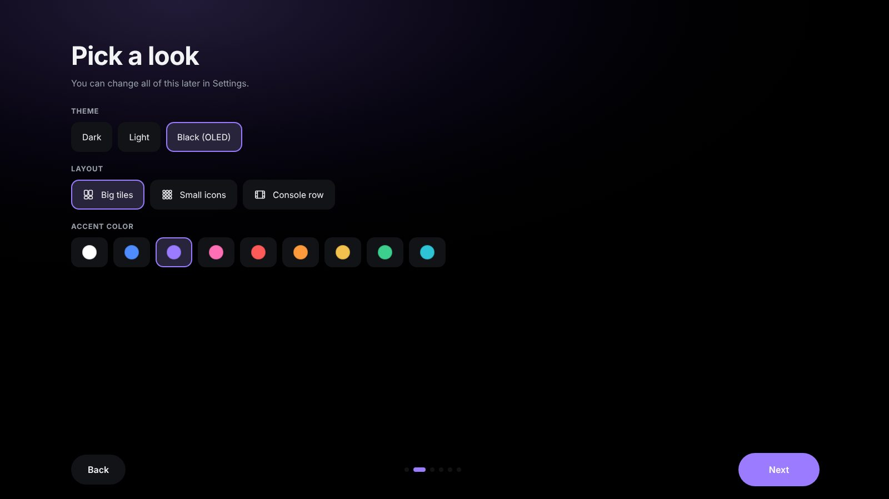
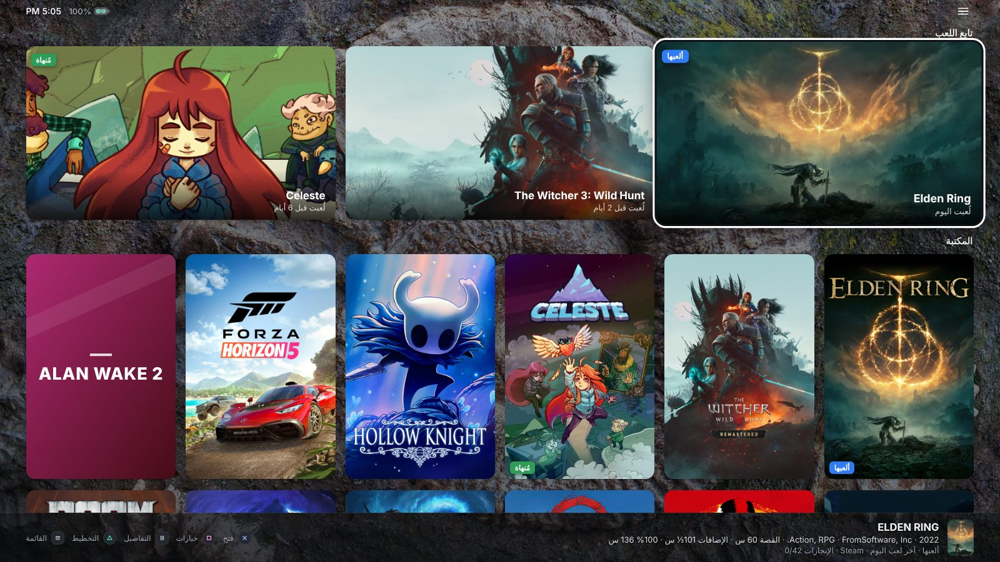

<div align="center">

# Arcade Launcher

### A free, console-style game launcher and home screen for Windows handheld PCs

**Turn your ROG Ally, Legion Go, MSI Claw, AYANEO, OneXPlayer, AOKZOE or GPD into a console.**
All your Steam, Xbox Game Pass, Epic, GOG, EA, Ubisoft, Battle.net, itch.io and emulator games in one full-screen home screen built for a controller and touch.

[](https://github.com/AMSRS/Arcade-Launcher/releases/latest)
[](https://github.com/AMSRS/Arcade-Launcher/releases)
[](#install)
[](#arcade-plus)
[](https://ko-fi.com/amsrs)

[**Download**](https://github.com/AMSRS/Arcade-Launcher/releases/latest) · [Website](https://amsrs.github.io/Arcade-Launcher/) · [Features](#features) · [Screenshots](#screenshots) · [FAQ](#faq)


</div>

---

## What is Arcade Launcher?

**Arcade Launcher** is a lightweight, full-screen **game launcher and Windows home screen replacement** for handheld gaming PCs. It replaces the Windows desktop with a console-like interface you can drive with a gamepad, a touch screen or a keyboard, so your handheld boots straight into your games, just like a Steam Deck, PlayStation or Xbox.

It finds the games you already have in **Steam, Xbox / Microsoft Store (Game Pass), Epic Games Store, GOG Galaxy, EA app, Ubisoft Connect, Battle.net, itch.io and RetroArch**, adds games from your own folders and emulators, and shows them in one library with cover art, trailers, playtime, **How Long To Beat** times and achievements.

It's a single small program: free, no account, no ads, no telemetry. If you've been looking for a **Playnite fullscreen alternative**, a **Steam Big Picture alternative for all your stores**, or a way to **hide the Windows desktop on your ROG Ally or Legion Go**, this is what Arcade Launcher is made for.

## Features

### 🎮 One library for every store
- Steam games, plus non-Steam shortcuts you added to Steam
- Xbox app / Microsoft Store / **PC Game Pass** games
- **Epic Games Store**, **GOG Galaxy**, **EA app**, **Ubisoft Connect**, **Battle.net** and **itch.io**
- **RetroArch** playlists and any other emulator with a ROM folder (PCSX2, Dolphin, DuckStation, PPSSPP…)
- Games in plain folders (each subfolder is one game; Arcade picks the right .exe)
- Your apps (Chrome, Discord, Spotify…) and folders on the same screen

### 🕹️ Built for handhelds and controllers
- **PlayStation-style button prompts**, D-pad and stick navigation, right stick scrolls like a mouse wheel
- A soft click and light **rumble** on every move (both adjustable)
- On-screen keyboard, full **touch** support and long-press menus
- **Home button support**: one press brings Arcade back from any game or app, two presses show **Open now**, every running app as a card you can switch to or close, like on a phone
- **Seamless game launching**: a launch screen hides the desktop while a game starts, and Arcade comes straight back when you quit

### 🖼️ Three layouts
- **Big tiles** with cover art and a **Continue** row of the games you played last
- **Small icons**, like a phone home screen, to see your whole library at once
- **Console row**: one row of games over big artwork, with optional moving trailer backgrounds, like the PS5 home screen ⭐

### 📊 Game info that helps you choose
- Trailers, descriptions, genres and developer
- **How Long To Beat** times (main story, extras, completionist)
- Your playtime and last played date
- **Achievements** with progress and unlock dates
- Install size, free space on the drive and a **battery estimate** learned from how long your battery really lasts in that game ⭐
- Play status: Playing, Backlog, Beaten, Completed

### ⚙️ Handheld tools
- **Quick settings**: volume, brightness, power mode, refresh rate, Wi-Fi, Bluetooth, sleep, restart and shut down
- **Per-game profiles**: refresh rate and power mode switch automatically when a game starts and switch back when you quit ⭐
- **Save backups**: automatic before and after you play, the last 10 kept, one-press restore
- A full **file manager**: browse, search, copy, move, rename, delete (to the Recycle Bin)
- **Search everything**: games, apps, settings and files from one box

### 🎨 Make it yours
- Dark, light and **black OLED** themes, plus accent colors ⭐
- Rotating wallpapers (Bing photos of the day) or your own pictures ⭐
- Quiet ambient background music, or your own music folder ⭐
- Rename games, change cover art, hide anything, build **collections**
- Sort by recently played, most played, A to Z, recently added or **shortest to beat**
- English and **Arabic** (right-to-left)

### 🛟 Looks after itself
- First-run setup that takes about a minute
- **Automatic updates** from GitHub
- Restarts by itself if it ever crashes, and keeps a log
- Backs up your whole setup so you can move it to a second handheld ⭐
- Optional **Steam friends** list: who's online and what they're playing ⭐

## Screenshots

| | |
|---|---|
|  |  |
| **Home** with the Continue row | **Console row** layout |
|  |  |
| **Game info**: HLTB times, achievements, status | **Small icons**, light theme |
|  |  |
| **Open now** app switcher (Home button twice) | **Quick settings** |
|  |  |
| **Options** for any game | **Settings** |
|  |  |
| **First-run setup** | **Arabic** |

## Supported devices

Arcade Launcher runs on any **Windows 10 or Windows 11** PC, and it's designed for 7 to 8.8 inch handheld screens:

- **ASUS ROG Ally / ROG Ally X / ROG Xbox Ally**
- **Lenovo Legion Go / Legion Go S**
- **MSI Claw**
- **AYANEO** (Air, 2S, Kun, Flip…)
- **ONEXPLAYER / OneXFly** and **AOKZOE**
- **GPD Win** series
- **Steam Deck running Windows**
- Laptops, mini PCs and TV / living-room PCs with a controller

Any XInput controller works (Xbox, PlayStation through Steam Input or DS4Windows, 8BitDo, built-in handheld controls).

## Install

1. Download the latest version from **[Releases](https://github.com/AMSRS/Arcade-Launcher/releases/latest)**:
   - **`ArcadeLauncher-Setup-x.y.z.exe`**: the normal installer. It installs just for your account (no admin prompt) and can be removed from Settings › Apps.
   - **`ArcadeLauncher-Portable-x.y.z.zip`**: unzip anywhere and run `Arcade.exe`.
2. Open it. The first-run setup asks for your language, look, game folders and apps.
3. Optional: turn on **Start with Windows** so your handheld boots straight into Arcade.

Requires Windows 10 or 11 (64-bit) and the Microsoft Edge WebView2 Runtime, which comes with Windows 11.

> **"Windows protected your PC"?** The app isn't code-signed yet, so SmartScreen may warn the first time. Click **More info › Run anyway**. Some antivirus tools are cautious about the Home button feature, because it listens for the Win+D key combo; Arcade never records or saves your keystrokes.

## Controls

| Button | Action |
|---|---|
| ✕ | Open / select |
| ○ | Back (on the home screen: return to the app you came from) |
| □ | Options for the focused tile (rename, hide, cover art, collections, profile, uninstall) |
| △ | Switch layout: tiles › icons › console row |
| View | Game info (trailer, times, achievements, saves) |
| Menu / ☰ | Menu (search, quick settings, settings, Open now, filters, sorting) |
| L1 / R1 | Jump a row |
| L2 / R2 | Filter by status, store or collection |
| L3 | Quick settings |
| R3 | Search |
| Right stick | Scroll |
| Home button | Back to Arcade · press twice for Open now |

Keyboard and touch work everywhere too: arrows, Enter, Esc, `M` menu, `I` info, `O` options, `Q` quick settings, or just start typing to search.

## FAQ

**Is Arcade Launcher free?**
Yes. Download it from the Releases page and use it on as many PCs as you like. Optional extras are available with a one-time [Arcade Plus](#arcade-plus) purchase.

**Is it a Steam Big Picture or Playnite alternative?**
It covers the same ground: a full-screen, controller-first library for all your games. The difference is that Arcade Launcher is made to *be* your handheld's home screen: it replaces the desktop, has a file manager, an app switcher for the Home button, quick settings and per-game power profiles, and it's set up in a minute without plugins.

**Does it work with Xbox Game Pass?**
Yes. Games installed through the Xbox app are found and launched automatically.

**Does it find Epic, GOG, EA and Ubisoft games?**
Yes, from the files and registry entries those launchers already keep. No logins needed. Games still start through their own launcher when the game needs it.

**Can I boot my ROG Ally or Legion Go straight into Arcade?**
Yes. Turn on **Start with Windows** in the first-run setup or in Settings. With the Home button feature on, pressing Home takes you back to Arcade instead of the desktop.

**Will it slow down my games?**
No. When a game is running, Arcade sits idle in the background. Moving trailer backgrounds and Steam friends are off unless you turn them on.

**Can I add emulators and ROMs?**
Yes. RetroArch playlists are picked up automatically, and any other emulator can be added in the settings file with its ROM folder.

**Where are my settings stored? Can I move them to another handheld?**
In `%LOCALAPPDATA%\Arcade`. Settings › Back up Arcade setup saves everything (settings, collections, statuses, custom art) to a zip you can restore on another PC.

**Is it safe?**
Arcade Launcher collects no data, shows no ads and needs no account. It talks to the internet only to fetch game art and info (Steam, HowLongToBeat, PCGamingWiki), wallpapers (Bing) and update checks (GitHub).

## Advanced settings

Almost everything is in **☰ › Settings**. A few extras live in `%LOCALAPPDATA%\Arcade\config.json`:

| Key | What it does |
|---|---|
| `exeOverrides` | The exact exe for a folder game: `{"Game Name": "D:\\Games\\X\\bin\\x.exe"}` |
| `steamIds` | Pin the Steam store page used for a game's art and info: `{"Game Name": 1091500}` |
| `emulators` | Your own emulators: `[{"name": "PCSX2", "exe": "C:\\Emu\\pcsx2-qt.exe", "args": "-fullscreen \"{rom}\"", "folder": "D:\\ROMs\\PS2", "extensions": [".iso", ".chd"]}]` |

Custom artwork can also be dropped in by hand: `<game name>_cover.jpg` (or `_hero`, `_logo`) into `%LOCALAPPDATA%\Arcade\custom`.

Other apps, like a handheld's own control center, can drive Arcade from the command line:

```
Arcade.exe --show | --hide | --toggle | --quit
```

## Arcade Plus

Arcade Launcher is free. **Arcade Plus** is an optional one-time purchase that unlocks a few extras (marked ⭐ above) and keeps development going:

- Console row layout with moving trailer backgrounds
- Accent colors and the black OLED theme
- Your own wallpapers and music
- Per-game profiles (refresh rate and power mode)
- Battery estimates for every game
- Steam friends
- Back up and move your whole setup to another handheld

Get it from **☰ › Get Arcade Plus** in the app. Keys are tied to your PC and work offline once activated.

## Support the project

- ⭐ **Star this repo**: it helps other handheld owners find Arcade
- ☕ **[Buy me a coffee on Ko-fi](https://ko-fi.com/amsrs)**
- 💜 **[GitHub Sponsors](https://github.com/sponsors/AMSRS)**
- 🐞 Bug reports and ideas are welcome in [Issues](https://github.com/AMSRS/Arcade-Launcher/issues)

## Credits

Game times from [HowLongToBeat](https://howlongtobeat.com); artwork, trailers and achievements from Steam; save locations from [PCGamingWiki](https://www.pcgamingwiki.com); wallpapers from Bing. Game names and artwork belong to their owners. Arcade Launcher isn't affiliated with Valve, Microsoft, Epic Games, GOG, EA, Ubisoft, Blizzard, Sony or any handheld maker.

## License

Arcade Launcher is free to download and use. It is not open source: copying, modifying, reverse engineering or redistributing it is not allowed. See [LICENSE](LICENSE).
